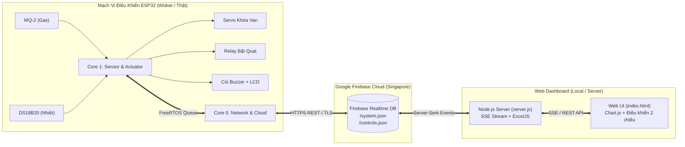

# 🚨 HỆ THỐNG CẢNH BÁO RÒ RỈ KHÍ GAS VÀ CHÁY THÔNG MINH (SMART GAS & FIRE ALARM SYSTEM)

> **ĐỒ ÁN CHUYÊN NGÀNH INTERNET OF THINGS (IoT)**  
> **Trường Đại học Công Thương TP.HCM (HUIT) - Khoa Công nghệ Thông tin**  
> **Tác giả:** Nguyễn Trọng Nguyên  
> **Kho lưu trữ GitHub:** [https://github.com/nguyentrongnguyen3004-eng/GasFireAlarm](https://github.com/nguyentrongnguyen3004-eng/GasFireAlarm)

---

## 📖 GIỚI THIỆU TỔNG QUAN

Hệ thống **Cảnh báo rò rỉ khí gas và cháy thông minh** là giải pháp IoT toàn diện ứng dụng vi điều khiển **ESP32**, cảm biến khí gas **MQ-2**, cảm biến nhiệt độ số **DS18B20**, cùng cơ cấu chấp hành tự động (**Servo khóa van gas, Relay bật quạt hút tản khí độc, Còi buzzer, Đèn LED và Màn hình LCD 16x2 I2C**).

Hệ thống được thiết kế theo kiến trúc **FreeRTOS Đa nhân (Dual-Core)** tối ưu hóa thời gian thực:
* **Nhân 1 (Core 1):** Xử lý đọc cảm biến, lọc nhiễu số, điều khiển cơ cấu chấp hành tức thì với tần số $100\text{Hz}$ (độ trễ $< 10\text{ms}$).
* **Nhân 0 (Core 0):** Xử lý kết nối Wi-Fi, tự động phục hồi kết nối, đồng bộ dữ liệu hai chiều với **Google Firebase Realtime Database (Singapore)** qua luồng HTTPS tái sử dụng (HTTP Reuse).
* **Web Dashboard:** Giám sát thời gian thực với công nghệ **Server-Sent Events (SSE)** độ trễ siêu thấp ($< 100\text{ms}$), hỗ trợ điều khiển từ xa, biểu đồ trực quan, nhật ký vĩnh viễn không mất khi F5 và xuất báo cáo sự cố chuyên nghiệp sang **Excel (.xlsx)**.



---

## 📂 CẤU TRÚC THƯ MỤC DỰ ÁN

Kho lưu trữ gồm 2 phần code chính được bố trí gọn gàng, độc lập và dễ dàng khởi chạy:

```text
GasFireAlarm/
├── src/
│   └── main.cpp              # Mã nguồn C++ Firmware ESP32 (FreeRTOS Đa nhân, tối ưu Wi-Fi & Firebase)
├── diagram.json              # Sơ đồ đấu nối dây linh kiện mô phỏng trên Wokwi
├── wokwi.toml                # File cấu hình nạp firmware cho tiện ích Wokwi VSCode
├── platformio.ini            # Cấu hình môi trường PlatformIO (ESP32 DevKit, thư viện phụ thuộc)
├── simulate_esp32.py         # Script Python giả lập mạch ESP32 chạy Local (0ms delay, không cần Internet)
│
├── web-dashboard/            # 🌐 THƯ MỤC NGUỒN WEBSITE DASHBOARD
│   ├── index.html            # Giao diện Web Dashboard thời gian thực (Tailwind CSS, Chart.js)
│   ├── server.js             # Backend Node.js kết nối Firebase SSE Stream, API REST, xuất file Excel
│   ├── package.json          # Danh mục thư viện phụ thuộc Node.js (exceljs)
│   └── README.md             # Hướng dẫn chi tiết riêng cho Web Dashboard
│
└── README.md                 # Tài liệu hướng dẫn toàn diện dự án
```

---

## ⚡ HƯỚNG DẪN PULL & KHỞI CHẠY HỆ THỐNG TỪ A - Z

### Bước 1: Clone (Pull) mã nguồn về máy tính

Mở **Terminal** (hoặc **PowerShell** / **Command Prompt**) trên máy tính của bạn và gõ:

```bash
# Clone kho mã nguồn từ GitHub
git clone https://github.com/nguyentrongnguyen3004-eng/GasFireAlarm.git

# Di chuyển vào thư mục dự án
cd GasFireAlarm
```

*(Nếu bạn đã clone từ trước, chỉ cần vào thư mục và gõ `git pull origin main` để cập nhật bản mới nhất).*

---

### Bước 2: Cài đặt và Khởi động Web Dashboard

Web Dashboard được viết bằng **Node.js**, có nhiệm vụ nhận dữ liệu tức thì từ Firebase và hiển thị bảng điều khiển.

```bash
# 1. Di chuyển vào thư mục web-dashboard
cd web-dashboard

# 2. Cài đặt các thư viện phụ thuộc (chỉ cần chạy lần đầu)
npm install

# 3. Khởi động Web Dashboard Server
npm start
```

Sau khi chạy, Terminal sẽ hiển thị:
```text
=======================================================
🚀 WEB DASHBOARD IOT ĐÃ KHỞI ĐỘNG THÀNH CÔNG!
🔗 Truy cập trực tiếp tại: http://localhost:5000
☁️ Firebase Cloud Sync:    https://smartgas-5b127-default-rtdb.asia-southeast1.firebasedatabase.app
📡 API Nhận dữ liệu ESP32: http://localhost:5000/api/sensor
🎮 API Điều khiển:         http://localhost:5000/api/control
=======================================================
```

👉 Mở trình duyệt web (Chrome, Edge, Cốc Cốc) và truy cập địa chỉ: **[http://localhost:5000](http://localhost:5000)**.

---

### Bước 3: Khởi động Mạch Vi Điều Khiển ESP32

Bạn có thể chọn **1 trong 3 cách** sau tùy thuộc vào môi trường của mình:

#### 🟢 CÁCH 1: Chạy trực tiếp trên Wokwi Web (Khuyên dùng - Nhanh & Đầy đủ nhất)
1. Mở liên kết dự án trên trình duyệt:  
   👉 **[https://wokwi.com/projects/475596142622555137](https://wokwi.com/projects/475596142622555137)**
2. Bấm nút **Play (Tam giác màu xanh)** ở thanh trên cùng.
3. ESP32 sẽ tự kết nối Wi-Fi `Wokwi-GUEST`, đồng bộ Firebase và bạn có thể **nghe rõ tiếng còi hú khi có sự cố**.

#### 🟡 CÁCH 2: Chạy mô phỏng trên VSCode (Offline / Local)
1. Mở thư mục `GasFireAlarm` trong **Visual Studio Code**.
2. Cài đặt tiện ích mở rộng **Wokwi Simulator** và **PlatformIO IDE** từ chợ tiện ích VSCode.
3. Mở file `diagram.json`.
4. Nhấn phím `F1` (hoặc `Ctrl + Shift + P`), gõ `Wokwi: Start Simulator` và nhấn **Enter**.
5. *Lưu ý bật âm thanh:* Click chuột vào giữa màn hình mạch điện Wokwi để mở khóa phát âm thanh còi hú.

#### 🔵 CÁCH 3: Chạy Giả Lập Local bằng Python (Phản hồi 0.001s - Không cần Internet)
Nếu bạn muốn demo trên lớp hoặc nơi có mạng Wi-Fi yếu, script này sẽ gửi dữ liệu trực tiếp vào Dashboard không cần qua Firebase:
```bash
# Đứng tại thư mục gốc GasFireAlarm, mở Terminal mới và chạy:
python simulate_esp32.py
```
* Phím `1`: Giả lập Rò rỉ khí Gas (Van tự đóng, quạt tự bật).
* Phím `2`: Giả lập Cháy & Nhiệt độ cao.
* Phím `3`: Giả lập Nguy hiểm khẩn cấp (Cả Gas + Cháy).
* Phím `4`: Trở lại trạng thái Bình thường.
* Phím `a`: Chế độ tự động tăng/giảm thông số ngẫu nhiên theo đồ thị hình Sin.

---

## 🔌 SƠ ĐỒ ĐẤU NỐI LINH KIỆN PHẦN CỨNG (PINOUT)

| Linh Kiện | Chân Linh Kiện | Chân ESP32 (GPIO) | Ghi chú chức năng |
| :--- | :--- | :--- | :--- |
| **Cảm biến Khí Gas (MQ-2)** | AOUT | **GPIO 35** (ADC1) | Đọc điện áp tương tự nồng độ khói/gas |
| | VCC / GND | 5V / GND | Nguồn cấp cảm biến |
| **Cảm biến Nhiệt độ (DS18B20)** | DQ (Data) | **GPIO 2** | Giao tiếp số chuẩn 1-Wire (10-bit resolution) |
| | VCC / GND | 3.3V / GND | Nguồn cấp cảm biến nhiệt |
| **Màn hình LCD 16x2** | SDA / SCL | **GPIO 21 / GPIO 19** | Giao thức I2C hiển thị thông số và trạng thái |
| | VCC / GND | 5V / GND | Nguồn cấp màn hình LCD |
| **Servo Khóa Van Gas (SG90)** | PWM (Signal) | **GPIO 33** | 0°: Van Mở, 90°: Van Khóa tự động |
| | V+ / GND | 5V / GND | Nguồn Servo |
| **Relay Quạt Hút Thông Gió** | IN (Signal) | **GPIO 26** | Kích mức CAO (HIGH) để đóng tiếp điểm bật quạt |
| | VCC / GND | 5V / GND | Nguồn nuôi Relay |
| **Còi Báo Động (Buzzer)** | Cực dương (+) | **GPIO 15** | Phát tần số 2000Hz (Cảnh báo) hoặc 2500Hz (Nguy hiểm) |
| | Cực âm (-) | GND | Nối mass |
| **LED Xanh Lá (Safe)** | Anode (+) qua trở 220Ω | **GPIO 16** | Báo trạng thái an toàn bình thường |
| **LED Đỏ (Alarm)** | Anode (+) qua trở 220Ω | **GPIO 17** | Chớp tắt cảnh báo khi có sự cố |

---

## 🎯 CÁC KỊCH BẢN VẬN HÀNH & KIỂM THỬ HỆ THỐNG

| Kịch bản kiểm thử | Điều kiện kích hoạt | Hành vi phần cứng (ESP32) | Phản hồi trên Web Dashboard |
| :--- | :--- | :--- | :--- |
| **1. Trạng thái An toàn** | Gas $< 1800$ và Temp $< 50^\circ\text{C}$ | LED Xanh sáng, LED Đỏ tắt, Còi tắt, Quạt tắt, Van gas Mở ($0^\circ$), LCD: `HE THONG AN TOAN`. | Badge Xanh `HỆ THỐNG AN TOÀN`. Đồ thị hiển thị thông số bình thường. |
| **2. Cảnh báo Rò rỉ Gas** | Gas $\ge 1800$ | LED Đỏ chớp nháy, Còi hú $2000\text{Hz}$, **Van tự động ĐÓNG ($90^\circ$)**, **Quạt tự động BẬT**, LCD: `CANH BAO RO GAS`. | Badge Cam `CẢNH BÁO RÒ RỈ GAS`. Lưu nhật ký sự cố. |
| **3. Cảnh báo Nhiệt độ cao**| Temp $\ge 50^\circ\text{C}$ | LED Đỏ chớp, Còi hú $2000\text{Hz}$, **Quạt tự động BẬT tản nhiệt**, Van gas ĐÓNG, LCD: `NHIET DO CAO`. | Badge Đỏ Cam `CẢNH BÁO NHIỆT ĐỘ CAO`. Lưu nhật ký sự cố. |
| **4. Nguy hiểm Khẩn cấp** | Gas $\ge 1800$ **VÀ** Temp $\ge 50^\circ\text{C}$ | Còi hú dồn dập $2500\text{Hz}$, LED Đỏ nhấp nháy nhanh, Van Khóa, Quạt Bật hết công suất, LCD: `! NGUY HIEM !`. | Badge Đỏ nhấp nháy `NGUY HIỂM CẤP ĐỘ CAO NHẤT`. |
| **5. Giờ Nấu Ăn (Cooking)**| Người dùng gạt nút trên Web | Hệ thống tự động cộng thêm $+500\text{ ADC}$ vào ngưỡng báo động gas để chống báo động giả khi nấu nướng. | Badge Tím `CHẾ ĐỘ NẤU ĂN KÍCH HOẠT`. |
| **6. Xuất Báo Cáo Sự Cố** | Bấm nút `Xuất Báo Cáo Excel` | Không ảnh hưởng đến mạch | Tải về file `BaoCao_SuCo_Gas_Chay_[Ngày].xlsx` có kẻ khung, phân loại màu sắc và chữ ký nghiệm thu. |

---

## 👥 THÔNG TIN ĐỒ ÁN & BẢN QUYỀN

* **Đơn vị:** Khoa Công nghệ Thông tin - Trường Đại học Công Thương TP.HCM (HUIT).
* **Sinh viên thực hiện:** Nguyễn Trọng Nguyên.
* **Mã nguồn:** Mã nguồn mở phục vụ mục đích học tập và nghiên cứu khoa học. Mọi đóng góp, báo lỗi (issue) hoặc yêu cầu kéo (pull request) đều được hoan nghênh.
